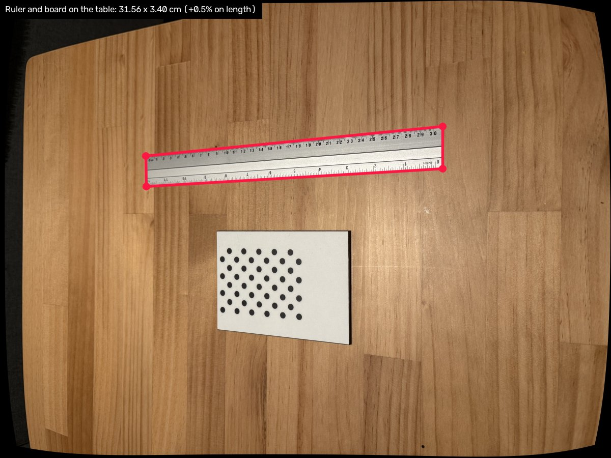
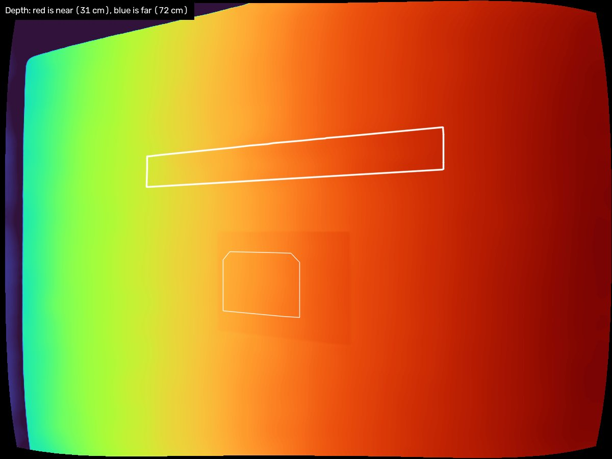
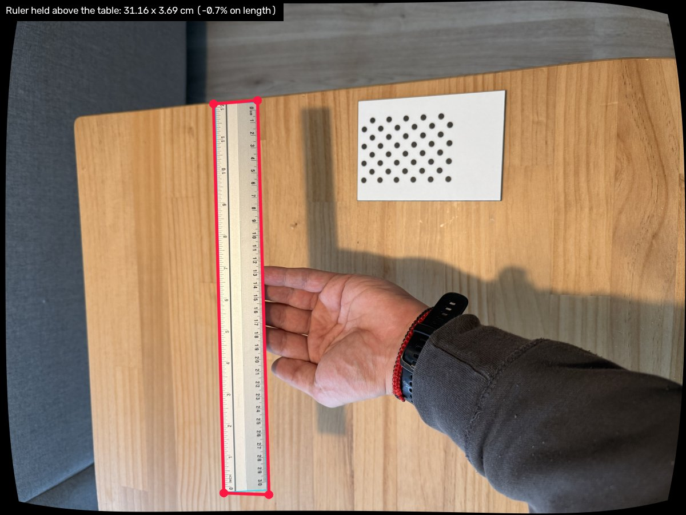
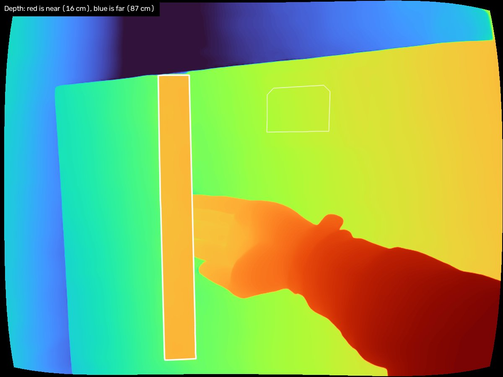
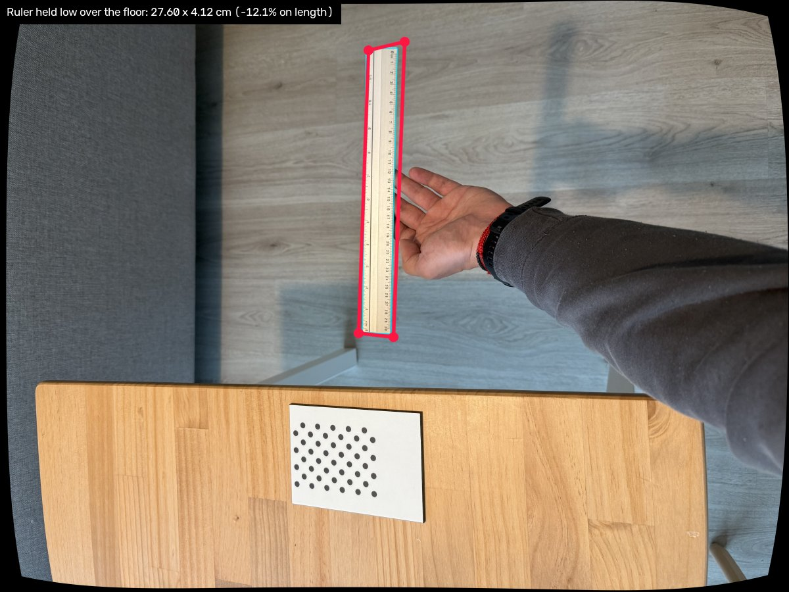
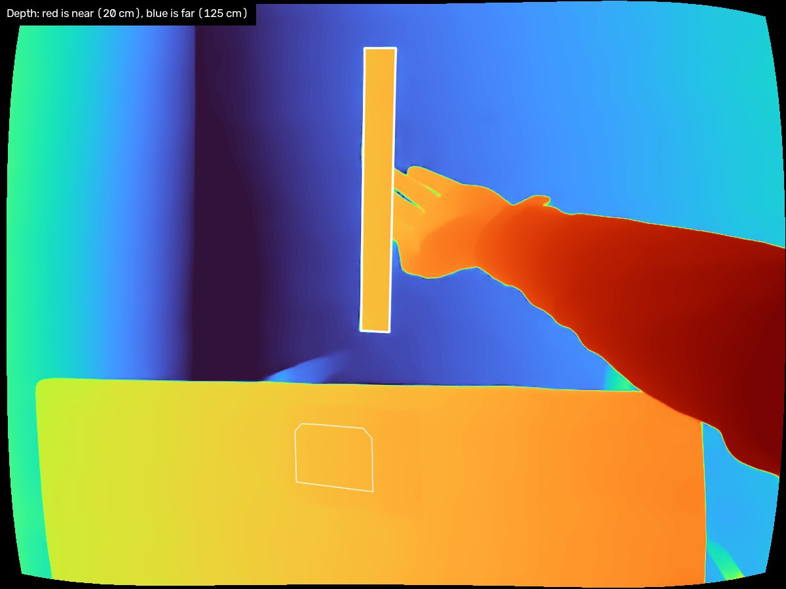
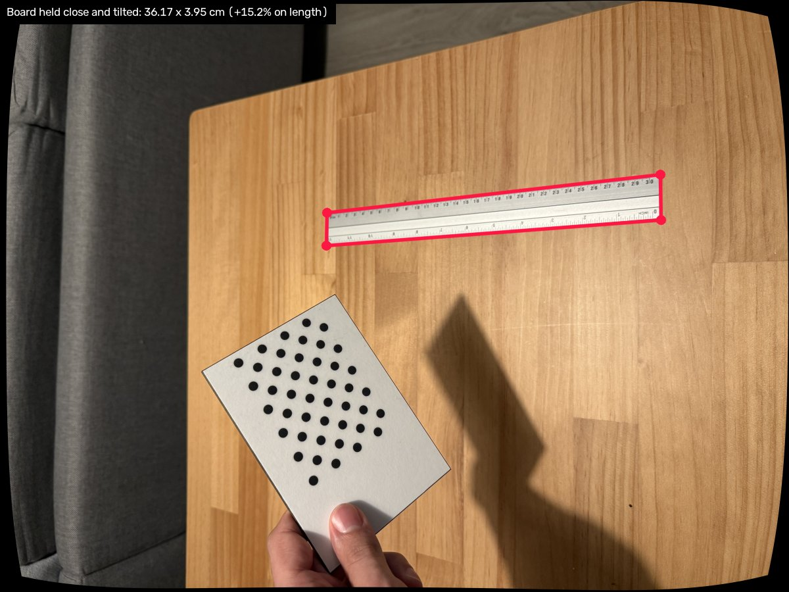
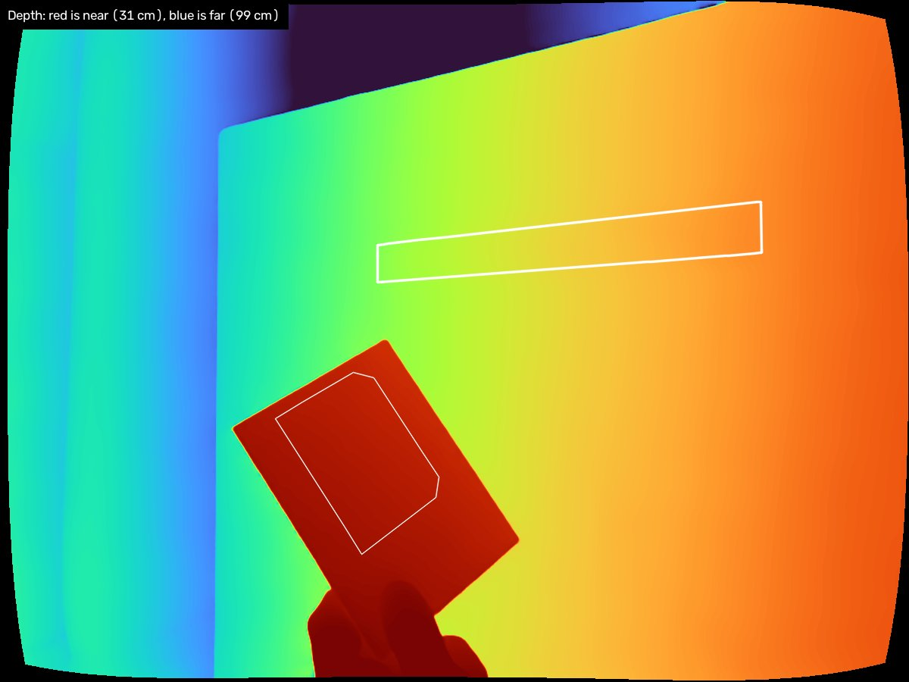

# single-view-metrology

Measure the real-world size of an object from a **single photograph**.

Put a printed dot pattern (the "board") in the frame next to the object. The
board gives the photo a known scale, a depth model gives the shape of the
scene, and together they turn a mask of the object into centimetres. No stereo
rig, no depth sensor, no second view.



## How it works

1. **Calibrate the camera once**, from 10-15 photos of the board.
2. For each photo of an object:
   - undistort it and find the board, whose pose gives exact distances on it;
   - predict depth for the whole photo with UniDepth V2, then rescale that depth
     by the one factor that puts the board where it really is;
   - lift the object's outline into 3D and report its **length and width** (the
     smallest rectangle around it) and the **longest distance** across it.

A photo whose board is missing or fits badly fails, rather than returning an
unscaled number.

## Requirements

- Python 3.12+ and [uv](https://docs.astral.sh/uv/)
- macOS for HEIC photos (converted with the built-in `sips`); JPEG, PNG, TIFF
  and BMP work anywhere
- The first run downloads the depth model's weights, about 1.4 GB. It runs on
  an NVIDIA GPU, Apple silicon or the CPU.

## Quickstart

```bash
uv sync
uv run python scripts/measure_object.py assets/demo --overlay-dir results/overlays
```

That measures the included photo of a 31.39 x 3.35 cm ruler, using the included
calibration of the phone that took it, and should report about 31.56 x 3.40 cm.

For your own camera and objects:

```bash
# 1. Once per camera: board photos in images/calibration_images/
uv run python scripts/calibrate_camera.py

# 2. Per object: photo.jpg + photo_mask.png in a folder
uv run python scripts/measure_object.py images/demo --overlay-dir results/overlays
```

Results go to `results/measurements.yaml` (`length_cm`, `width_cm`,
`longest_distance_cm`, plus how well the board fitted), and each overlay shows
the measured rectangle on the photo.

## Calibration

**Print the board.** It is OpenCV's 4x11 asymmetric circle grid. Fix it to
something flat and stiff. Then measure its **pitch** and put it in
`configs/boards/circle_grid_4x11.yaml`: the distance from the first row of dots
to the last (11th) row, divided by 10. Every measurement scales with this
number, so measure it rather than trust the print size.

**Shoot 10-15 photos** with varied views: straight on, tilted 30-45 degrees each
way, near and far, and with the board in the corners of the frame. The tilted
and corner shots are what pin down the lens distortion.

**Run** `uv run python scripts/calibrate_camera.py`. Settings are in
`configs/calibration.yaml`; `--overlay-dir` writes a check image per photo. The
result, `camera_parameters/iphone_camera.yaml`, holds the focal length,
principal point, distortion and the fit's RMS error in pixels. Under 1 px is
fine for measuring; above 2 px usually means a bent board or a blurred photo.

## Taking a photo to measure

- Use the **calibrated camera at 1x zoom** and full resolution. Digital zoom
  changes the camera's geometry and is not detected.
- Keep the board **close to the object and at about its distance from the
  camera**, resting on something rather than held in the hand.
- The object can lie beside the board or be raised a little above it. Held far
  out in mid-air, away from the board, it measures worse.
- The **mask** must match the photo pixel for pixel. To snap a mask exported by
  another tool onto the photo's grid:
  `uv run python scripts/prepare_mask.py photo.heic rough_mask.png`

## Accuracy

Measured on a 31.39 cm ruler, read against its own printed scale, with an
iPhone 16 Pro:

| Setup | Length error |
|---|---|
| Ruler and board on the table | +0.5% |
| Ruler held above the table | -0.7% |
| Ruler held out over the floor, beyond the table | -12.1% |
| Ruler on the table, board held close to the camera and tilted | +15.2% |

Left, the measurement. Right, the depth the model predicted once the board had
set its scale: red is near the camera, blue is far.

| Measurement | Depth |
|---|---|
|  |  |
|  |  |
|  |  |
|  |  |

**What the tests show**

- **Near the board, the result is good.** Lying next to the board, and held
  above it, the ruler came out within 1% of its true length.
- **Far from the board, it is not.** Held out over the floor, or with the board
  lifted towards the camera, the error grew to 12-15%. The board sets the scale
  for what is near it, and that scale does not stretch across a large gap.
- **So put the board right next to what you measure.**
- **Length is more reliable than width.** The ruler's 3.35 cm width was 1.4%
  over on the table and 10-23% over in the other photos.

One caveat: the board's dot spacing was set using this ruler and one other
object, so the first row is a consistency check more than an independent test.

**The depth model.** UniDepth V2 looks at the photo alone and predicts how far
away every pixel is, which is what lets an object off the board's surface be
measured at all. It gets the shape of a scene well and its overall size poorly,
so the board supplies the size. Of five metric depth models compared on an
object of known size, it was the only one within a few percent.

## Limitations

- **Transparent objects** do not work: the depth model sees through them.
- **Length and width are for box-like objects.** They are the sides of the
  smallest rectangle that fits around the object, which suits a ruler, a card
  or a book. A shape such as a triangle has no single rectangle that fits it
  best, so for those use the longest distance, which is reported as well.
- One calibrated camera, one board, tested at 25-55 cm.
- The mask is an input; segmentation is not part of this project.

## Two things to know about the photos

The calibration describes the camera pixel by pixel, so a photo has to reach
the pipeline exactly as the camera made it.

- **Do not resize or crop.** The calibration fits the full, original image
  only. A photo of any other size is refused.
- **Rotation is ignored on purpose.** A phone held sideways does not turn the
  pixels; it adds a note saying "show this rotated". The pipeline ignores that
  note and works on the pixels as stored, because the calibration was made from
  them. If you write your own code around the calibration, load images the same
  way (in OpenCV, `cv2.IMREAD_IGNORE_ORIENTATION`), or the numbers come out
  wrong with no error.

## Layout

```
src/svmetrology/     # the library
  board.py           # the printed circle grid
  detection.py       # finding it in a photo
  calibration.py     # camera intrinsics
  pose.py            # the board's pose and the depth of its plane
  depth.py           # UniDepth depth, rescaled to the board
  extent.py          # an outline's convex hull and longest chord, in pixels
  measure.py         # length, width and longest distance in cm
  imaging.py         # photo and mask loading
  config.py          # YAML settings
  reporting.py       # logs, reports, check images
  _vendor/           # UniDepth V2, trimmed to inference
scripts/             # command-line entry points
configs/             # settings; configs/boards/ describes the printout
camera_parameters/   # calibration output
tests/               # pytest
```

## Development

```bash
uv run pytest
uv run ruff format . && uv run ruff check --fix .
```

CI also checks for dead code, duplicated code and dependency drift.

## Credits and licence

This project's own code is under the **MIT licence** (`LICENSE`), with one
exception, the depth model.

The depth model is **UniDepth V2** by Luigi Piccinelli and colleagues
([lpiccinelli-eth/UniDepth](https://github.com/lpiccinelli-eth/UniDepth)).
`src/svmetrology/_vendor/unidepth.py` is a copy of it trimmed to inference; the
file's header lists the changes, and its licence,
**CC BY-NC 4.0 (non-commercial)**, sits beside it as `LICENSE-unidepth`. The
weights are downloaded from the authors' Hugging Face repository on first run.

So while it uses UniDepth, the project as a whole is for non-commercial use.
